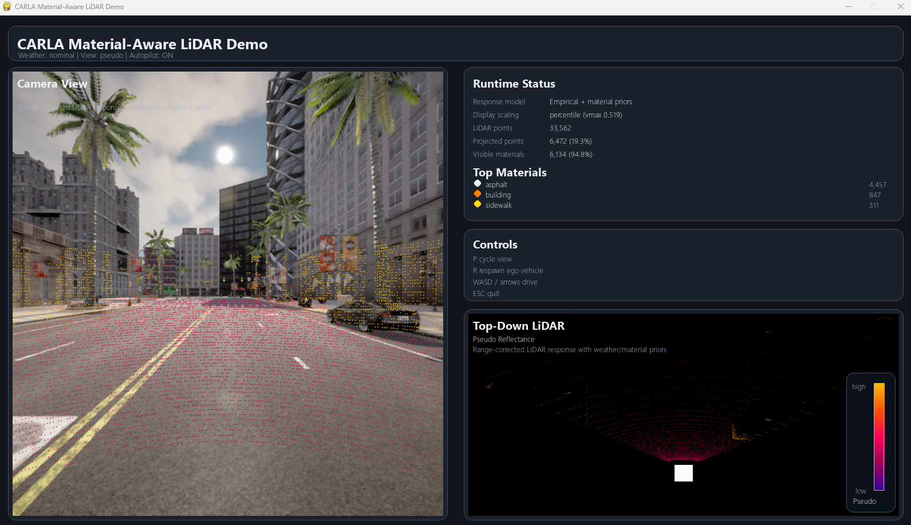
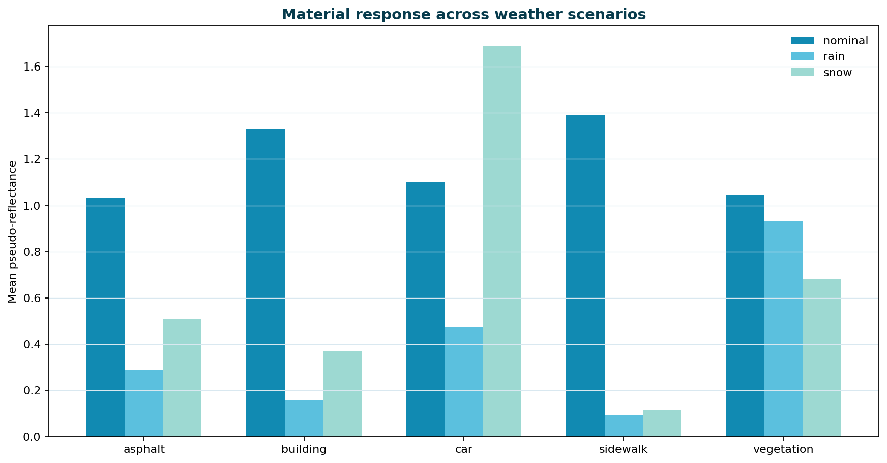
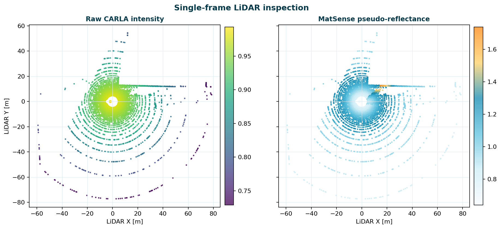
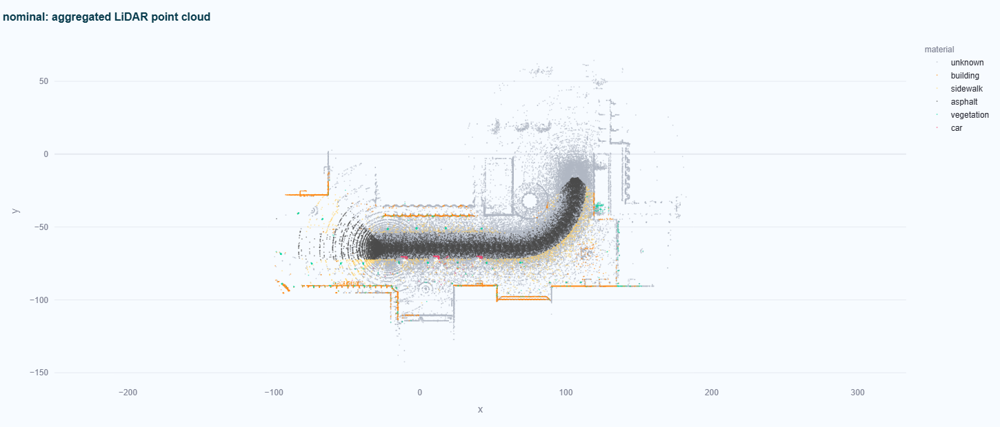

# MatSense: Material-Aware LiDAR Modeling for Simulation-Based Testing of Autonomous Driving Systems


MatSense measures how a real LiDAR responds to different materials, freezes
that response as a versioned sensing profile, and applies it to the LiDAR
stream CARLA delivers to the system under test, without modifying the agent.
The same scenario can then be driven under the sensing realisations the paper
compares:

| realisation | what the agent receives | `--mode` |
| --- | --- | --- |
| unmodified | CARLA's own response | `intensity` |
| uniform | one scale per frame, at the level MatSense delivers on that frame | `global` |
| MatSense | each return scaled by its material and condition, from the frozen profile | `material` |
| shuffled | MatSense's own factors, permuted among the returns of each range bin | `shuffled` |
| level | a constant chosen by configuration, for diagnostics | `level` |

Uniform and shuffled match MatSense's intensity level on every frame, so only a
difference against them is attributed to the materials.

This repository holds **the tool**: the Streamlit dashboard, the CARLA/pygame
runtime viewer, the material-aware LiDAR response, the dataset recorder, and a
small demo dataset so the analyzer works without CARLA.

It deliberately does **not** hold the experiment campaigns, their outputs, the
analysis scripts or the figures. Those are distributed as a replication package,
so a checkout stays small and there is one obvious thing to run.

## What is calibrated, and what is not

The per-material response is estimated from real recordings; the tool reports it
as a measurement-configuration-independent intensity after Laasch et al. (2025),
which is the product of the scanner constant and the reflectance. **It is not a
reflectance**, it depends on the scanner, and a profile calibrated for one
instrument does not transfer to another by rescaling.

Being precise about which numbers are measured matters more than the numbers
themselves:

The frozen profile is `realbag_empirical_v4` (paper, Table 5):

| | asphalt | building | car | sidewalk | vegetation | unknown |
| --- | --- | --- | --- | --- | --- | --- |
| nominal β | 0.5472 | 1.0000 | 0.7113 | 0.6529 | 0.8335 | 0.40, declared |
| rain α | 0.8876 | 0.9774 | 0.9179 | 0.9303 | 0.9713 | 0.70, declared |

- **Measured**: β and α for the five runtime classes. The eight calibration
  subclasses (building wall and glass; car paint, glass and tyre; asphalt,
  sidewalk, vegetation) are aggregated onto them, because CARLA tags whole
  objects (the granularity gap, Section 5.1).
- **Declared, not measured**: `unknown` and every snow ratio. At runtime a
  return without a calibrated class is left exactly as CARLA produced it.
- **Which recordings**: β from three nominal and α from three rainy traversals
  of the calibration road, with one range model g(R) shared across them
  (nominal asphalt, equal-population bins, bin means, isotonic fit, 20-60 m).
  Three nominal and two rainy recordings of a different road are never used for
  fitting and serve only as the held-out test (E1). A third rainy recording of
  that road was exported but is neither fitted nor evaluated; that is what the
  "twelve recordings" in the profile's `notes` refers to.

The profile file is left byte-for-byte as the campaigns used it: its SHA-256 is
the profile identity every run records.

## Visual overview




RGB view with projected LiDAR returns, and the top-down material-aware response.



Material response across weather conditions.



Single-frame CARLA intensity against the MatSense response.



Aggregated point cloud over a trajectory.

## Features

**Run Viewer.** Launches the bundled CARLA/pygame viewer, and configures
weather, view mode, trajectory, parked vehicles, autopilot and dataset
recording. Drives a recorded trajectory when one is given, or CARLA autopilot
when none is.

**Profile.** Shows a material profile: per-material coefficients, which ones
are measured and which declared, the factor applied to CARLA's intensity, and
the CARLA-class-to-material mapping.

**Experiment.** Plans and runs closed-loop campaigns with a PCLA agent in the
paper's block design (Section 6.4): one block per condition and seed, holding
unmodified, a second unmodified run, uniform, MatSense and shuffled in an order
drawn at random per block. Results compare the realisations on route
completion, collisions, cross-track error and TTC with paired statistics.

**Dataset Analyzer.** Reads a recorded dataset from
`output_dataset/<scene_id>/<scenario>/`, shows the aggregated top-down cloud
over the trajectory, inspects single frames, and compares the material-aware
response against CARLA's own intensity per material class and per condition.

## Repository layout

```
matsense_streamlit_app
|-- .streamlit/config.toml
|-- bundled_toolkit/
|   |-- configs/          calibrated profiles and material overrides
|   |-- scripts/          CARLA runtime: viewer, recorder, response model, campaign runner
|   `-- src/material_aware_toolkit/
|-- docs/
|   |-- assets/
|   |-- USER_GUIDE.md
|   `-- DATASET_FORMAT.md what a recorded run contains and how to read it
|-- sample_data/scene_001/{nominal,rain,snow}
|-- app.py
|-- CITATION.cff
`-- requirements.txt
```

## Installation

```bash
git clone https://github.com/dera8/Matsense.git
cd Matsense
python3 -m venv .venv
source .venv/bin/activate
pip install -r requirements.txt
```

Requirements: Python 3.10+, Streamlit, pandas, NumPy, Plotly, pygame. The Run
Viewer additionally needs CARLA running locally and a Python environment where
`import carla` works. **The Dataset Analyzer needs neither.**

The Browse buttons use `tkinter`. On Ubuntu install it with
`sudo apt install python3-tk` if the file dialog does not open; in a headless
environment, paste paths into the text fields instead.

## Usage

```bash
streamlit run app.py
```

Then open the URL Streamlit prints, usually `http://localhost:8501`.

### Run Viewer

Needs CARLA running with the desired map and the CARLA Python API importable.
Typical settings:

```
Weather          = nominal | rain | snow (snow is not calibrated)
View             = RGB overlays | Material classes | Pseudo-reflectance | CARLA raw intensity
Pseudo scale     = fixed
Material profile = realbag_empirical_v4 by default (the calibrated profile)
Trajectory TXT   = optional recorded UTM trajectory
Trajectory JSON  = optional CARLA-local trajectory
Parked JSON      = optional parked-vehicle layout
Autopilot        = used when no trajectory is given
Save dataset     = records frames, clouds and labels
```

To use a full toolkit checkout instead of the bundled runtime, set the path in
the sidebar or export `MATSENSE_TOOLKIT`.

### Dataset Analyzer

The demo dataset under `sample_data/scene_001` loads by default and contains a
small nominal, rain and snow subset. A recorded dataset has this layout:

```
output_dataset/scene_001/nominal/
  frame_metadata.csv     per-frame pose, weather and coverage
  scenario_metadata.json map, spawn, trajectory and sensor settings
  calibration.json       intrinsics and the camera-from-LiDAR transform
  actors.csv             pose, velocity and box of surrounding actors
  lidar_raw/frame_XXXXXX.npz     xyz and CARLA's own intensity
  lidar_labels/frame_XXXXXX.npz  material, instance id, range, MatSense intensity
```

`lidar_raw/intensity` and `lidar_labels/pseudo_final` are the same returns
before and after the transformation. That pairing is the point of the recording
and the one thing a plain CARLA capture does not give you.
`docs/DATASET_FORMAT.md` documents the rest.

The analyzer reports frames per scenario, route duration and distance, points
per frame, projection and known-material ratios, and the response per material
against CARLA's intensity.

## Agent integration

The operator is a single function, N×4 → M×4, called inside the agent's LiDAR
callback (Section 5.5). For PCLA (commit 07d4d5d, agent `lav_lav`) the hook is
`bundled_toolkit/patches/pcla_perturb_fn.patch`; the Experiment page checks it
is applied before a campaign starts. The agent's LiDAR is mounted at
(0, 0, 2.40) m with 64 channels, 85 m range, 600 000 points/s, 10 Hz and a
vertical field of view from -30 to +10 degrees; the co-located semantic LiDAR
completes a full turn per 20 Hz frame (1 300 000 points/s) and returns are
matched by direction within 0.40 degrees.

## Not in this repository

The paper's calibration pipeline, analysis scripts, scenario definitions and
figure generators. They are part of the replication package rather than of the
tool. The Experiment page includes its own generic campaign runner.

## Citation

```bibtex
@article{matsense2026,
  title  = {{MatSense}: Material-Aware {LiDAR} Modeling for Simulation-Based Testing of Autonomous Driving Systems},
  author = {Russo, Debora and Stocco, Andrea and Gambi, Alessio and Mazzocca, Nicola and Vittorini, Valeria},
  note   = {Submitted to the Journal of Systems and Software},
  year   = {2026},
  doi    = {TBD}
}
```

## License

Not yet chosen. Add a `LICENSE` file before relying on this repository being
reusable: without one, the default is that no permission is granted.
